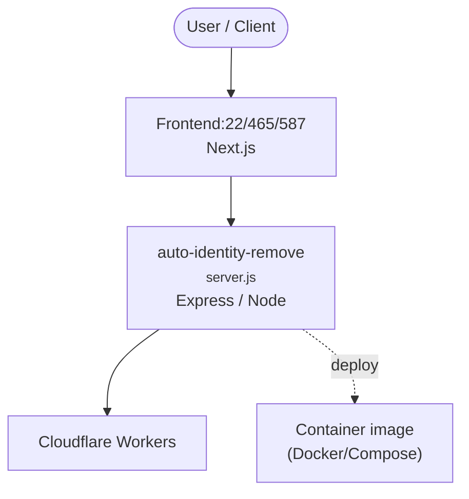

# Context Map — `auto-identity-remove`

> Auto-generated architecture & deployment context map. Summarizes the core application, container/cloud footprint, and database connections. Regenerate after significant structural changes.

**Repo:** `avnit/auto-identity-remove` · **Fork** · Public · Primary language: JavaScript · Default branch: `main` · Files: 219

**Description:** Automated data broker opt-out runner — removes your personal info from 30+ people-search sites on a monthly schedule

## 1. Core application

auto-identity-remove

- **Frameworks / runtime:** Express / Node, Next.js
- **Entry points:** `dashboard/server.js`
- **Listens on port(s):** 22, 465, 587, 993, 1071, 1074

## 2. Containers & cloud applications

**Containers:**
- `.dockerignore`
- `Dockerfile`
- `docker-compose.yml`

**Detected cloud platforms / services:** Cloudflare Workers

## 3. Database connections

_No database drivers or connection strings detected._

## 4. Architecture diagram

## 5. Security posture

- **Static scan findings:** 29 high, 8 medium

| Severity | Rule | File:Line |
|---|---|---|
| high | generic-secret-assign | `dashboard/server.test.js:232` |
| high | generic-secret-assign | `dashboard/server.test.js:279` |
| high | generic-secret-assign | `dashboard/server.test.js:305` |
| high | generic-secret-assign | `dashboard/server.test.js:316` |
| high | generic-secret-assign | `dashboard/server.test.js:668` |
| high | generic-secret-assign | `dashboard/server.test.js:679` |
| high | generic-secret-assign | `dashboard/server.test.js:724` |
| high | generic-secret-assign | `dashboard/server.test.js:751` |

---
_Generated by repo context-mapping pass on 2026-08-13._